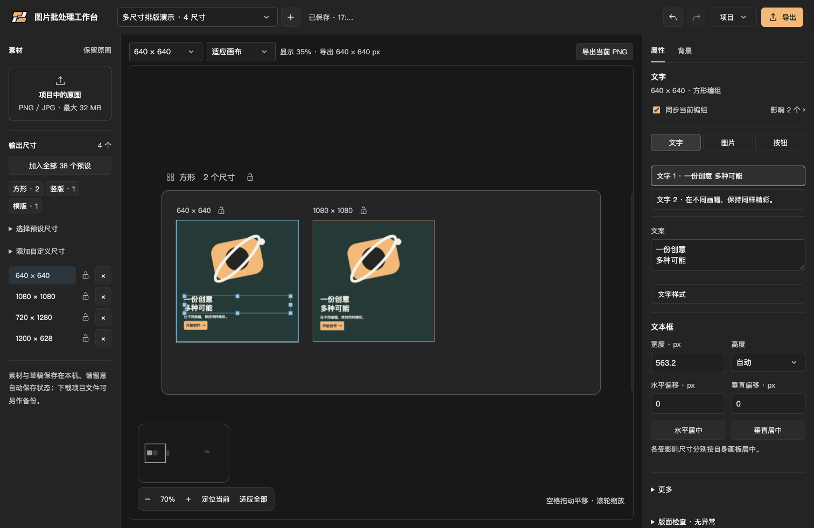

<p align="center">
  
</p>

<h1 align="center">Image Batch Workbench</h1>

<p align="center">One creative. Multiple sizes.<br>Remove backgrounds, edit layered layouts, and export image batches locally.</p>

<p align="center">
  <a href="README.md">简体中文</a> · <strong>English</strong>
</p>

<p align="center">
  <a href="#features">Features</a> ·
  <a href="#quick-start">Quick start</a> ·
  <a href="#workflow">Workflow</a> ·
  <a href="#development-and-testing">Development</a> ·
  <a href="#contributing">Contributing</a>
</p>



<p align="center"><sub>Actual application screenshot with synthetic geometric demo artwork. The application UI is currently in Chinese.</sub></p>

Image Batch Workbench (图片批处理工作台) is a local tool for turning a set of source images, brand marks, and copy into social graphics, advertising banners, and promotional assets in multiple sizes. Independent artboards, group-scoped editing, and batch export bring repetitive layout work into a single workspace.

No cloud image API or account is required. Background removal uses local segmentation; it does not generate or repaint image content. **macOS with Chrome** is the currently verified environment.

## Features

| Feature | What it does |
| --- | --- |
| **Multi-size layouts** | 38 presets across square, portrait, narrow portrait, landscape, and banner groups, plus custom dimensions. |
| **Grouped infinite canvas** | Browse multiple artboards, focus a group or the current size, and navigate with pan, zoom, and a minimap. |
| **Layered editing** | Edit the subject, logo, two text blocks, and button separately; move, resize, center, and adjust object-specific properties. |
| **Group-scoped synchronization** | Apply subsequent edits to eligible sizes in the same shape group, isolate individual sizes, or explicitly overwrite a group from the current layout. |
| **Local background removal** | Keep original and cutout versions of both subject and logo images; run BiRefNet-General on your CPU. |
| **Multiple backgrounds** | Match backgrounds by dimensions or aspect ratio, combine all backgrounds with selected sizes, or use only the current background. |
| **PNG and ZIP export** | Export the current PNG or selected sizes as a batch; use pngquant in the local full version or browser PNG encoding online, preserving dimensions and alpha transparency. |
| **Batches and recovery** | Autosave local batches, keep up to 10 undo/redo steps, and download self-contained JSON projects as separate backups. |

### Images, text, and backgrounds

- **Images:** import PNG or JPEG, retain the original, switch to the cutout result, and adjust scale, position, cropping, and edge feathering. Subjects fit within their image area by default; cropping is opt-in.
- **Text:** manual line breaks, weight, italics, color, straight or curved underlines, strokes, shadows, and separators; resize text frames and layers.
- **Object properties:** contextual controls for text, images, and buttons; select subject and logo independently and center them horizontally or vertically.
- **Backgrounds:** solid color, gradient, transparency, or multiple imported images; adjust background zoom and focal position independently for each size.
- **Previews:** fit-to-canvas or actual-size viewing. Content outside an artboard remains editable; exports include only the artboard area. Layout checks flag issues such as overflowing text and insufficient image resolution.

### Predictable synchronization, independent adjustments

Live group synchronization affects **eligible, non-isolated sizes in the same shape group only**. It does not cross shape groups. Turn it off to edit only the current size. Switching sizes or re-enabling synchronization does not immediately overwrite existing layouts.

The explicit group overwrite action is separate from the live synchronization switch. It copies layout, text styling, subject, logo, and copy to eligible targets while preserving each target's background matching choice, zoom, and focal position. Individual locks, group locks, and legacy isolation states affect eligibility; expand the scope summary to inspect the actual targets before applying changes.

### Size presets

| Group | Count | Examples in pixels |
| --- | ---: | --- |
| Square and near-square | 9 | 300 × 250, 640 × 640, 1080 × 1080, 1080 × 1350 |
| Portrait | 9 | 300 × 600, 720 × 1280, 1080 × 1920 |
| Narrow portrait | 3 | 120 × 600, 160 × 600, 300 × 1050 |
| Landscape | 5 | 1200 × 600, 1200 × 628, 1920 × 1080 |
| Banner | 12 | 320 × 50, 728 × 90, 750 × 300, 970 × 250 |

Add all 38 presets in one action without duplicating existing sizes. Custom sizes use the same aspect-ratio grouping rules.

## Quick start

### Requirements

- **Verified environment:** macOS with local Chrome. Windows, Linux, Safari, and Firefox have not completed compatibility validation.
- **Runtime prerequisites:** [uv](https://docs.astral.sh/uv/getting-started/installation/) and [pngquant](https://pngquant.org/). The setup script uses Python 3.11.
- **Internet access for initial setup:** Python, dependencies, and approximately 1 GB of segmentation weights are downloaded. Once prepared, normal image processing does not require a cloud service.
- **Node.js and npm are only needed for development tests.** Daily use requires no frontend build server.

### Install and run

Clone the project and enter its root directory. On macOS, prerequisites can be installed using an existing Homebrew installation:

```sh
git clone https://github.com/Aaminly/image-batch-workbench.git
cd image-batch-workbench
brew install uv pngquant
./setup.sh
./run.sh
```

Open **[http://127.0.0.1:8765](http://127.0.0.1:8765)**. Keep the terminal running and press `Ctrl+C` to stop the service.

For other devices on the same LAN, use `./run.sh --lan` and open the printed `http://LAN-IP:8765` address. The localhost entry still works. Allow incoming connections on your trusted network if prompted by the system firewall. The default interface needs a private IPv4 address; restart after changing networks.

`setup.sh` creates `.venv/`, installs pinned Python dependencies, and downloads the BiRefNet-General weights into `.models/`. For subsequent sessions, run `./run.sh`; on macOS, you can also double-click `启动工作台.command`.

If `uv`, `pngquant`, or model weights are missing, install the prerequisites or rerun `./setup.sh`. If another instance of this workbench already uses port 8765, open its existing page. If a different program occupies the port, free it before starting.

## Workflow

1. **Prepare assets:** import images, then select any image object in the right panel for local background removal. Each image retains its own original and result; switching preserves its layout. Legacy image and logo objects are supported too. Background-library images are excluded.
2. **Choose sizes:** add presets or custom dimensions, then focus the desired group or artboard on the canvas.
3. **Build the layout:** select text, image, or button objects to edit copy, size, position, and style. Configure fills or image backgrounds in the background tab.
4. **Review scope and details:** inspect synchronization targets, lock sizes or disable synchronization as needed, and check extreme aspect ratios, overflow, cropping, and resolution.
5. **Export and back up:** export the current PNG, or use the top-right export panel to select sizes and download a ZIP. Use the project menu to save a self-contained JSON backup.

### Background matching and export

Matching prefers backgrounds with exactly the same width and height, then falls back to matching aspect ratios. Multiple backgrounds matching a size all participate. Unmatched sizes are listed and block batch export rather than being silently skipped.

PNG files go directly into the ZIP root, usually named `WIDTHxHEIGHT.png`. Multiple outputs for the same size receive a background number and name to avoid collisions. The transparency checkerboard is preview-only. Batch export can be cancelled, and completed archives can be downloaded again during their local retention period, or within the current page session online.

The local full version uses pngquant's lossy color quantization with quality parameters of 65–90. Pixel dimensions remain unchanged. Compression failures are reported explicitly; if compression offers no size reduction, the original PNG is retained. This is not the TinyPNG service.

### Common shortcuts

Canvas shortcuts apply outside text entry and modal interactions. Input fields retain their native editing behavior.

| Action | Shortcut or gesture |
| --- | --- |
| Undo / redo | `Ctrl / ⌘ + Z`, `Ctrl / ⌘ + Shift + Z`; also `Ctrl + Y` |
| Pan | `Space + left-drag`, or middle-button drag |
| Zoom | Mouse wheel; `Ctrl / ⌘ + +` / `-` |
| Pan horizontally | `Shift + wheel` |
| Set view scale | `Ctrl / ⌘ + 0` for 100%; `Ctrl / ⌘ + 1`–`9` for 10%–90% |
| Clear canvas selection | Click empty space or press `Escape` |
| Nudge the selected layer | Arrow keys; hold `Shift` for larger steps |
| Paste an image | Replace the selected image, or add one when no image is selected; text fields still paste text |

## Local data and privacy

Images travel between your browser and the local service; **they are not sent to a cloud image-processing service**. By default, the server binds only to `127.0.0.1`, validates origins and host names, and serves static files only from `web/`. This is a single-machine tool, without the accounts and permissions required for collaboration or public hosting.

`--lan` listens on all IPv4 interfaces while allowing only loopback hosts and the selected LAN IP Host. It has no accounts or transport encryption: reachable devices can read and write shared server drafts. Use trusted networks only, without port forwarding or public exposure; Host validation does not replace a firewall. Browser refresh checkpoints are isolated by origin, so pending localhost edits do not migrate to the IP origin. Wait for saving to finish before switching addresses.

| Location or data | Purpose |
| --- | --- |
| `.models/` | Local segmentation weights |
| `.local/drafts/` | Batch drafts, deduplicated assets, and editing history |
| Browser storage | Per-tab view state and recovery checkpoints for uncommitted edits |
| `work/` | Temporary export jobs, ZIP archives, and development evidence; completed ZIPs are retained for approximately 20 minutes by default |
| Downloaded project JSON | A separate user-created backup containing images and layouts |

Autosave is not a separate backup. Forced shutdowns, power loss, disk failures, or incomplete local transactions can still lose recent edits. Save important projects to JSON. Conflicting updates from multiple tabs stop saving and display a recovery prompt; save a backup before reloading the stored version.

`.venv/`, `.models/`, `.local/`, `work/`, and `node_modules/` are listed in `.gitignore` and should not be committed as product source.

## Current limitations

- **No generative image editing:** no outpainting, inpainting, semantic image generation, or brush-based edge repair.
- **Review cutouts:** complex backgrounds, hair, and transparent objects can leave artifacts or lose detail. Processing time depends on hardware and input; results are not guaranteed for every asset.
- **Input and project limits:** up to 32 MB and 24 megapixels per input image; 120 MB per project. Embedded assets also have a Base64 length validation limit.
- **Artboard limits:** up to 40 sizes per project, 24–6000 px per side, and 16 megapixels per output image.
- **Background and export capacity:** no fixed background count, but project size, memory, and disk limits still apply. Export capacity is not unlimited.
- **UI language:** currently Chinese. This English README does not imply an English application interface.
- **Platform coverage:** macOS with Chrome is the verified environment; other operating systems and browsers remain unverified.

## Online preview

**[Open the interactive preview](https://aaminly.github.io/image-batch-workbench/)** (GitHub Pages, built and deployed by Actions).

The preview supports local image imports, canvas editing, synchronization, undo/redo, JSON backups, and browser-local PNG/ZIP downloads without uploading images. Online PNGs do not undergo pngquant optimization; ZIP export supports multiple sizes/backgrounds, cancellation, and redownload within the current page. Capacity is subject to browser memory. The session resets on refresh. Cutouts, server batches, and autosave require the local full version. See [preview details](docs/ONLINE_PREVIEW.md#english-summary) for capability boundaries and hosting considerations.

## Development and testing

The frontend uses native ES modules and Canvas. The backend uses Python and FastAPI. Background removal runs through rembg, BiRefNet-General, and ONNX Runtime CPU; PNG compression uses local pngquant.

```text
web/                  Interface, canvas, state, and export logic
server.py             Local service, background removal, PNG compression
drafts.py             Draft, asset, and editing-history persistence
archive_sessions.py   Chunked uploads and temporary ZIP jobs
archive_files.py      ZIP file handling
tests/                Node, Python, and browser tests
docs/                 Public documentation and demo assets
```

Install development tools and run the basic state tests:

```sh
npm ci
npm test
```

`npm test` runs the `state`, `editor-state`, `history`, `pages-session`, and `pages-export` test files; it is not the full regression suite. Select targeted tests for the behavior being changed, for example:

```sh
node --test tests/element-media.test.mjs tests/group-sync.test.mjs
```

Browser tests and some backend tests can write or clear drafts. Read the relevant test source first and run against an isolated instance with a temporary data root; **do not point them at your everyday instance on port 8765**. Tests are in `tests/`. Some historical browser scripts depend on local evidence files or older UI controls, so not every script is a standalone test entry point.

## Contributing

Contributions to features, documentation, translations, and compatibility are welcome. When reporting a problem, include the operating system, browser version, reproduction steps, expected and actual results, and a screenshot or minimal project with private assets removed. Do not attach personal images or local drafts to public reports.

Read the relevant implementation and existing tests before making changes. Preserve local processing, original assets, synchronization isolation, and accurate export dimensions. Update both language versions for feature changes and describe what was actually verified.

## License and acknowledgments

The project's own code and documentation are available under the [MIT License](LICENSE). Third-party software, models, and external assets retain their respective terms; see [third-party notices](THIRD_PARTY_NOTICES.md).

Built with:

- [rembg](https://github.com/danielgatis/rembg) — local background removal.
- [BiRefNet](https://github.com/ZhengPeng7/BiRefNet) — image segmentation.
- [ONNX Runtime](https://github.com/microsoft/onnxruntime) — CPU model inference.
- [FastAPI](https://github.com/fastapi/fastapi) and [Pillow](https://github.com/python-pillow/Pillow) — local APIs and image processing.
- [pngquant](https://pngquant.org/) — PNG color quantization.
- [Playwright](https://github.com/microsoft/playwright) — browser automation.

Dependencies, model weights, and tools remain subject to their respective upstream licenses. See `requirements.txt` and `package-lock.json` for dependency versions.
