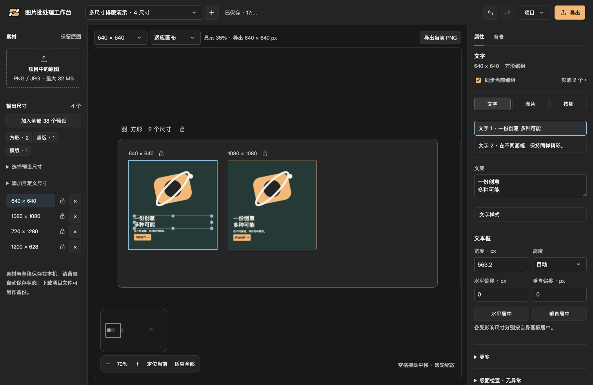

<p align="center">
  
</p>

<h1 align="center">图片批处理工作台</h1>

<p align="center">一份创意，多种尺寸。<br>在本机完成图片抠图、分层排版与批量导出。</p>

<p align="center">
  <strong>简体中文</strong> · <a href="README.en.md">English</a>
</p>

<p align="center">
  <a href="#功能亮点">功能亮点</a> ·
  <a href="#快速开始">快速开始</a> ·
  <a href="#使用流程">使用流程</a> ·
  <a href="#开发与测试">开发与测试</a> ·
  <a href="#参与贡献">参与贡献</a>
</p>



<p align="center"><sub>实际运行截图，使用合成几何素材演示；界面目前为中文。</sub></p>

图片批处理工作台是一个本地运行的多尺寸图片排版工具，适合将同一套主体、品牌标识和文案制作成社交图片、广告横幅或宣传素材。它提供可独立微调的画板、同组同步编辑和批量导出，让重复排版集中在一个工作区完成。

无需云端图片 API 或账号。去背景使用本地分割模型，不生成或补画图片内容。当前以 **macOS + Chrome** 为已验证运行环境。

## 功能亮点

| 功能 | 你可以做什么 |
| --- | --- |
| **多尺寸排版** | 使用 38 个预设尺寸，按方形、竖版、窄竖版、横版与横幅分组；也可添加自定义尺寸。 |
| **编组无限画布** | 同屏浏览多个画板，定位编组或当前尺寸，使用小地图、平移与缩放检查整体版式。 |
| **分层编辑** | 保留主体、Logo、两段文字和默认按钮，可继续新增文字、图片及按钮；独立编辑、拖动、缩放和居中。 |
| **同组同步** | 将后续修改同步到同一形状组内可同步的尺寸；单独锁定尺寸，或主动用当前版式覆盖组内。 |
| **本地去背景** | 主体与 Logo 均可保留原图和抠图结果；使用 BiRefNet-General 在本机 CPU 上分割。 |
| **多背景合成** | 按尺寸或比例匹配背景，也可选择全部背景与尺寸组合，或只使用当前背景。 |
| **PNG / ZIP 导出** | 导出当前 PNG，或勾选尺寸批量打包；本机版使用 pngquant，在线版使用浏览器 PNG 编码；均保留目标像素和透明通道。 |
| **多批次与恢复** | 自动保存本机草稿，保留最多 10 步撤销 / 重做；导出含素材的 JSON 项目作为独立备份。 |

### 图片、文字与背景

- **图片**：导入 PNG / JPEG；保留原图，可切换抠图结果；支持缩放、位置调整、裁切和四周羽化。默认完整容纳主体，裁切需要主动开启。
- **文字**：支持手动换行、字重、斜体、颜色、直线 / 弧线下划线、描边、阴影与文字分隔线；可调整文本框和图层大小。
- **对象属性**：右侧按文字、图片、按钮显示对应设置，每类列表下方可继续新增对象；新增后立即选中，图片完成选取与校验后才添加。新增对象支持独立文案、样式、位置和大小，按钮底色互不影响；沿用编组同步、锁定、撤销及保存规则。
- **背景**：纯色、渐变、透明，或导入多张背景图片；每个尺寸可独立调整背景缩放与焦点。
- **预览**：适应画布或原尺寸显示；画布外内容仍可编辑，导出只保留画板范围。版面检查提示文字溢出和分辨率不足等问题。

### 同步范围清晰，细节仍可独立调整

“同步当前编组”仅影响**同一形状组内、未被隔离的尺寸**，不会跨组同步。关闭后只修改当前尺寸；切换尺寸或重新开启同步不会立即覆盖已有版式。

“用当前版式覆盖组内”是一次主动覆盖，与实时同步开关分开。它复制可同步目标的版式、文字样式、主体、Logo 和文案，同时保留目标尺寸的背景匹配选择、缩放与焦点。单尺寸锁、组锁及旧项目的隔离状态会影响可同步范围，操作前可展开范围摘要查看实际目标。

### 预设尺寸

| 分组 | 数量 | 示例（像素） |
| --- | ---: | --- |
| 方形及近方形 | 9 | 300 × 250、640 × 640、1080 × 1080、1080 × 1350 |
| 竖版 | 9 | 300 × 600、720 × 1280、1080 × 1920 |
| 窄竖版 | 3 | 120 × 600、160 × 600、300 × 1050 |
| 横版 | 5 | 1200 × 600、1200 × 628、1920 × 1080 |
| 横幅 | 12 | 320 × 50、728 × 90、750 × 300、970 × 250 |

支持一键加入全部 38 个预设；已有尺寸不会重复加入。自定义尺寸按相同比例规则归组。

## 快速开始

### 环境要求

- **已验证**：macOS、本机 Chrome。Windows、Linux、Safari 与 Firefox 尚未完成兼容性验证。
- **运行依赖**：[uv](https://docs.astral.sh/uv/getting-started/installation/) 与 [pngquant](https://pngquant.org/)。安装脚本使用 Python 3.11 环境。
- **首次安装需要联网**：下载 Python / 依赖和约 1 GB 的本地分割权重；准备完成后，正常图片处理无需云端服务。
- **Node.js / npm 仅用于开发测试**，日常使用无需启动前端构建服务。

### 安装并启动

克隆项目后进入项目根目录。在 macOS 上，可通过已安装的 Homebrew 准备依赖：

```sh
git clone https://github.com/Aaminly/image-batch-workbench.git
cd image-batch-workbench
brew install uv pngquant
./setup.sh
./run.sh
```

打开 **[http://127.0.0.1:8765](http://127.0.0.1:8765)**。保持终端运行，按 `Ctrl+C` 停止服务。

需要同一局域网的其他设备访问时，改用 `./run.sh --lan`，打开终端打印的 `http://本机局域网IP:8765`。原本的 localhost 入口仍可使用；若系统防火墙询问，请允许可信网络的入站连接。默认网卡必须具有私有 IPv4 地址；网络切换后请重启服务。

`setup.sh` 会创建 `.venv/`、安装锁定版本的 Python 依赖，并将 BiRefNet-General 权重下载到 `.models/`。安装完成后，后续只需运行 `./run.sh`；macOS 也可双击 `启动工作台.command`。

若提示缺少 `uv`、`pngquant` 或模型，请先完成安装或重新运行 `./setup.sh`。若 8765 端口已被本工作台占用，可直接打开已有页面；若被其他程序占用，请先释放端口。

## 使用流程

1. **准备素材**：导入图片，从右侧列表选择任意图片元素即可本地抠图；每张分别保留原图与结果，可随时切换并检查边缘。旧项目中的图片与 Logo 同样支持。背景库不参与抠图。
2. **选择尺寸**：添加预设或自定义尺寸，在画布中定位需要编辑的编组或画板。
3. **编辑版式**：选择文字、图片或按钮，调整文案、大小、位置与样式；在“背景”页签设置底色或背景素材。
4. **检查同步与细节**：确认同步范围，按需锁定尺寸或关闭同步；逐个检查极端比例、文字溢出、裁切与清晰度。
5. **导出与备份**：导出当前 PNG，或点击右上角“导出”选择尺寸并下载 ZIP；通过“项目 → 保存项目”下载自包含 JSON 备份。

### 背景匹配与导出

默认先匹配宽高完全一致的背景，没有时再匹配相同比例背景。同一尺寸匹配多张背景时，均参与合成；存在未匹配尺寸时会提示并阻止批量导出，不会静默跳过。

ZIP 中的 PNG 直接放在根目录，通常按 `宽x高.png` 命名；同尺寸多张成品追加背景序号和名称，避免覆盖。透明棋盘格只用于预览，不会写入成品。批量导出支持取消，完成后可重新下载；本机版有临时保留期，在线版仅在当前页面内有效。

本机完整版的压缩使用 pngquant 有损颜色量化，质量参数为 65–90。目标像素不变；压缩失败明确报错，体积没有收益时保留原 PNG。它不等同于 TinyPNG 服务。

### 常用快捷键

以下画布快捷键在非文本输入、非模态操作场景下使用；输入框保留原生编辑行为。

| 操作 | 快捷键 / 手势 |
| --- | --- |
| 撤销 / 重做 | `Ctrl / ⌘ + Z`、`Ctrl / ⌘ + Shift + Z`；另支持 `Ctrl + Y` |
| 平移画布 | `Space + 左键拖动`，或中键拖动 |
| 缩放画布 | 滚轮；`Ctrl / ⌘ + +` / `-` |
| 横向平移 | `Shift + 滚轮` |
| 设置视图缩放 | `Ctrl / ⌘ + 0` 为 100%；`Ctrl / ⌘ + 1`–`9` 为 10%–90% |
| 取消画布选择 | 点击空白处，或 `Escape` |
| 微调所选图层 | 方向键；`Shift` 加速 |
| 粘贴图片 | 选中图片时替换该张，否则新增；输入框内仍为粘贴文字 |

## 本地数据与隐私

图片在浏览器与本机服务之间传输，**不发送到云端图片处理服务**。默认服务仅监听 `127.0.0.1`，包含同源与 Host 校验，静态资源目录仅为 `web/`。本项目面向单机使用，不提供多人协作或公网部署所需的账号与权限系统。

`--lan` 模式监听所有 IPv4 网卡，但只接受本机入口和启动时选中的局域网 IP Host。它没有账号和加密传输，可连接设备均能读写服务器上的共享草稿；请仅在可信局域网使用，不做端口转发或公网暴露。Host 校验不能替代防火墙。浏览器刷新保护按访问地址隔离，localhost 的未提交检查点不会自动迁移到 IP 地址；切换前请等待保存完成。

| 路径 / 数据 | 用途 |
| --- | --- |
| `.models/` | 本地分割模型权重 |
| `.local/drafts/` | 多批次草稿、去重素材及操作历史 |
| 浏览器本地存储 | 标签页视图状态与未提交编辑的恢复检查点 |
| `work/` | 临时导出任务、ZIP 和开发取证文件；完成的 ZIP 默认保留约 20 分钟 |
| 下载的项目 JSON | 用户主动保存的独立备份，包含图片与版式 |

自动保存不等于独立备份。强制关闭、断电、磁盘故障或尚未完成的本地事务仍可能造成最近编辑丢失；重要项目请另存 JSON。多标签页版本冲突时会停止保存并提示处理，先保存备份，再重新载入缓存。

`.venv/`、`.models/`、`.local/`、`work/` 和 `node_modules/` 已列入 `.gitignore`，不应作为产品源码提交。

## 当前边界

- **不是生成式图片工具**：没有扩图、补画、语义改图或画笔修边功能。
- **保留图中文字**：图片属性中可勾选「保留文字」，将文字与主体合并；再勾选「文字分层」可生成可独立移动的透明文字图片层。取消保留会禁用分层，选项只影响下一次抠图。文字定位使用 macOS 本地 Vision（需 Xcode 命令行工具），不上传图片。当前针对文字周围底色平稳的素材；复杂底纹、过小文字或文字覆盖主体无法可靠分层时会明确报错并保留现有内容，不补画被遮挡的人物。
- **抠图需要检查**：复杂背景、发丝与透明物体可能残留或误删；耗时取决于硬件与输入，不能保证所有素材效果。
- **素材与项目容量**：单张输入不超过 32 MB、2400 万像素；项目总大小不超过 120 MB，单项内嵌素材另受 Base64 长度校验。
- **画板容量**：每个项目最多 40 个尺寸；单边 24–6000 px，每张不超过 1600 万像素。
- **背景与导出容量**：没有固定的背景张数上限，但仍受项目容量、内存和磁盘限制；不代表无限量导出。
- **界面语言**：目前为中文。英文 README 不代表产品已有英文界面。
- **平台覆盖**：目前以 macOS + Chrome 为已验证环境，其他系统与浏览器尚未验收。

## 在线预览

**[打开在线交互预览](https://aaminly.github.io/image-batch-workbench/)**（GitHub Pages，由 Actions 构建发布）。

预览支持图片导入、画布编辑、多尺寸同步、撤销 / 重做、JSON 项目备份，以及浏览器本地 PNG / ZIP 导出，图片不上传。在线 PNG 未经 pngquant 量化优化，ZIP 支持多尺寸、多背景、取消和当前页面重新下载，容量受浏览器内存限制。内容仅保留在当前页面，刷新会重置；抠图、服务器批次和自动保存请使用本机完整版。实现边界与托管评估见 [在线预览说明](docs/ONLINE_PREVIEW.md)。

## 开发与测试

前端使用原生 ES modules 与 Canvas，后端使用 Python / FastAPI；抠图由 rembg、BiRefNet-General 与 ONNX Runtime CPU 执行，PNG 压缩依赖本机 pngquant。

```text
web/                  前端界面、画布、状态与导出逻辑
server.py             本机服务、抠图与 PNG 压缩
drafts.py            草稿、素材与操作历史持久化
archive_sessions.py   分片上传与临时 ZIP 任务
archive_files.py      ZIP 文件处理
tests/               Node、Python 与浏览器测试
docs/                公开文档与演示素材
```

安装开发工具并运行基础状态测试：

```sh
npm ci
npm test
```

`npm test` 覆盖 `state`、`editor-state`、`history`、`pages-session` 与 `pages-export` 五个测试文件，不代表全套回归。可按改动范围选择专项测试，例如：

```sh
node --test tests/element-media.test.mjs tests/group-sync.test.mjs
```

浏览器及部分后端测试会写入或清理草稿。请先阅读相应测试源码，在使用临时数据根目录的隔离实例上运行；**不要把它们指向日常使用的 8765 实例**。测试脚本位于 `tests/`，部分历史浏览器脚本依赖本机取证文件或旧版操作入口，不能将所有脚本视为开箱即用的统一测试入口。

## 参与贡献

欢迎改进功能、文档、翻译与兼容性。报告问题时，请提供操作系统、浏览器版本、复现步骤、预期与实际结果，以及去除私人素材后的截图或最小项目。不要在公开反馈中附上私人图片或本机草稿。

修改前先查看相关实现和现有测试；保持本机处理、原图保留、同步隔离与导出像素准确等行为。功能变化请同步更新中英文文档，并说明实际验证范围。

## 许可与致谢

本项目自身代码和文档采用 [MIT 许可证](LICENSE)，便于使用、修改和分发。第三方软件、模型与外部素材保留各自许可，详见 [第三方说明](THIRD_PARTY_NOTICES.md)。

感谢以下项目：

- [rembg](https://github.com/danielgatis/rembg)：本地背景移除。
- [BiRefNet](https://github.com/ZhengPeng7/BiRefNet)：图像分割模型。
- [ONNX Runtime](https://github.com/microsoft/onnxruntime)：CPU 模型推理。
- [FastAPI](https://github.com/fastapi/fastapi)、[Pillow](https://github.com/python-pillow/Pillow)：本机 API 与图像处理。
- [pngquant](https://pngquant.org/)：PNG 颜色量化压缩。
- [Playwright](https://github.com/microsoft/playwright)：浏览器自动化验证。

第三方依赖、模型权重和工具各自适用其上游许可；版本见 `requirements.txt` 与 `package-lock.json`。
